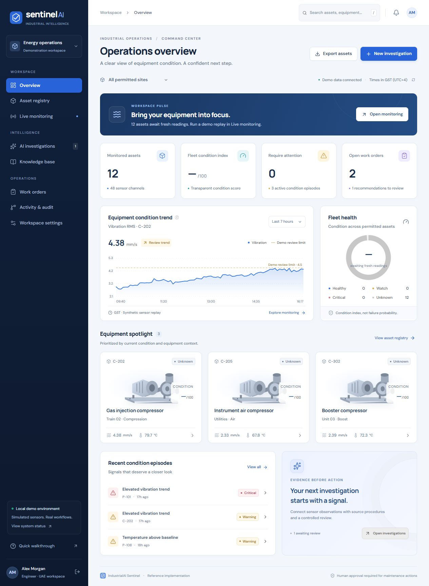

# IndustrialAI Sentinel

Industrial equipment monitoring and maintenance decision support for energy, oil and gas workflows. A runnable portfolio reference built with React, TypeScript, FastAPI and SQLAlchemy.



## What it does

- Registers assets and sensor channels with stable identities, canonical site access and configurable freshness.
- Accepts independent sensor events with validated unit conversion, atomic batches, duplicate protection and source evidence.
- Issues expiring, asset-scoped gateway credentials with rotation, revocation and hash-only storage.
- Projects eligible four-channel event frames into equipment snapshots after explicit human review.
- Reviews rejected telemetry through evidence retention, controlled correction/replay and reasoned dismissal.
- Tracks equipment trends, condition episodes, explainable risk heuristics and what-if comparisons.
- Searches site-scoped document text with citations and retains original uploaded files privately with checksum-checked download.
- Supports versioned investigations, independent maintenance approval, work-order tracking and uncertain-response reconciliation through a local CMMS simulator.
- Records audit history and runs isolated SQLite backup/restoration checks, including retained original files.

## Scope

This is a local reference application with synthetic equipment and a simulated CMMS. Isolation Forest evaluation uses synthetic data; the knowledge assistant uses lexical/hashed-vector retrieval and extractive answers. No live PLC/SCADA control, vendor CMMS connection, hosted LLM, physical-device attestation, OCR, OIDC/SSO, calibrated failure probability or RUL is claimed. It is not a completed industrial production deployment.

## Run on Windows

Prerequisites: Python 3.12, Node.js 24 or newer and pnpm 11.25.0.

```powershell
npm install -g pnpm@11.25.0
py -3.12 -m venv .venv
.\.venv\Scripts\python.exe -m pip install -r requirements.lock.txt
pnpm install --frozen-lockfile
pnpm build
.\.venv\Scripts\python.exe scripts/run.py
```

Open http://127.0.0.1:8127 and keep the server terminal running. Press Ctrl+C to stop. The repository contains frontend source, so build it before running. It excludes the generated `dist/` directory, installed dependencies, runtime database and private uploaded documents. First launch creates fresh local demonstration data. Never commit your own `.env`, database or gateway credentials.

Once prerequisites are installed, `start-windows.ps1` performs dependency installation, frontend build and startup.

## Run on macOS or Linux

```bash
npm install -g pnpm@11.25.0
python3.12 -m venv .venv
.venv/bin/python -m pip install -r requirements.lock.txt
pnpm install --frozen-lockfile
pnpm build
.venv/bin/python scripts/run.py
```

## Local demonstration accounts

Use the role cards on the sign-in page or a seeded demo account. The default local-only demo password is `SentinelDemo!2026`; it is a deliberately published development value, not a private credential.

| Role | Email |
|---|---|
| Admin | admin@sentinel.local |
| Engineer | engineer@sentinel.local |
| Approver | approver@sentinel.local |
| Planner | planner@sentinel.local |
| Technician | technician@sentinel.local |

Changing a personal password signs out existing sessions and removes that account from the shared demo selector. Do not expose demo mode to the public Internet. See [operations](docs/OPERATIONS.md) before working with non-demo data.

## Development and verification

```powershell
pnpm build
.\.venv\Scripts\python.exe -m pytest -q
.\.venv\Scripts\python.exe scripts/evaluate_model.py
```

The GitHub publication copy was checked on 20 November 2026: all 172 SQLite backend tests and the frontend production build passed. See [publication verification](docs/evidence/github-source-verification.json).

The prior Step 9 verification records 172 tests passing on SQLite and isolated PostgreSQL 18.6, plus a logical restore, checked upgrade preservation and a local HTTP gateway sender test. See [verification scope](docs/VERIFICATION.md) and [Step 9 evidence](docs/evidence/phase3-step9-verification.json). Synthetic model results are not industrial accuracy claims. GitHub Actions builds the frontend and runs the backend suite; workflow results should be checked on each commit.

For frontend development run `pnpm dev` in a second terminal while FastAPI runs on port 8127. The Vite development origin is configured in `vite.config.ts` and `.env.example`.

## Telemetry sender

With the local app running, sign in as Admin and open Workspace settings > Telemetry gateway access. Issue a credential for one asset. In a separate terminal run:

```powershell
.\.venv\Scripts\python.exe scripts/send_gateway_sample.py
```

Or open the Windows paste window:

```powershell
powershell -NoProfile -STA -ExecutionPolicy Bypass -File .\scripts\Open-Sentinel-Sender.ps1 -ProjectPath "$PWD"
```

The sender submits one four-channel sample. Keep the key private. Event ingestion does not publish a snapshot: separately inspect Equipment alignment, review the current frame and explicitly publish it while eligible. The built-in manual test frame is another labelled test source, not gateway proof.

## Database and deployment

Default persistence is SQLite under `data/`. SQLAlchemy, Alembic migrations through revision `0008` and isolated PostgreSQL verification are included. For a fresh managed database, configure `DATABASE_URL`, run `python -m alembic upgrade head`, and follow the operations guide. Existing installations require a checked backup and upgrade workflow; do not overwrite an active database.

The Dockerfile builds the frontend and runs a non-root API container. `compose.yaml` is an optional local PostgreSQL configuration; deployment in your own environment still needs validation. GitHub hosts this source code; uploading it does not deploy the FastAPI application or create a working GitHub Pages portal.

## Documentation

- [Architecture](docs/ARCHITECTURE.md)
- [Implementation status and enterprise extensions](docs/IMPLEMENTATION_STATUS.md)
- [Demo walkthrough](docs/DEMO_WALKTHROUGH.md)
- [Telemetry gateway API and boundaries](docs/PHASE_3_STEP_9.md)
- [Sensor snapshot alignment](docs/PHASE_3_STEP_4.md)
- [Rejected data review](docs/PHASE_3_STEP_5.md)
- [Original document archive](docs/PHASE_3_STEP_8.md)
- [Backup and recovery](docs/PHASE_3_STEP_7.md)
- [Reliability Lab](docs/RELIABILITY_LAB.md)
- [Operations](docs/OPERATIONS.md)
- [Verification](docs/VERIFICATION.md)
- [Third-party notices](docs/THIRD_PARTY_NOTICES.md)

## License

[MIT](LICENSE). Third-party components retain their own notices.
