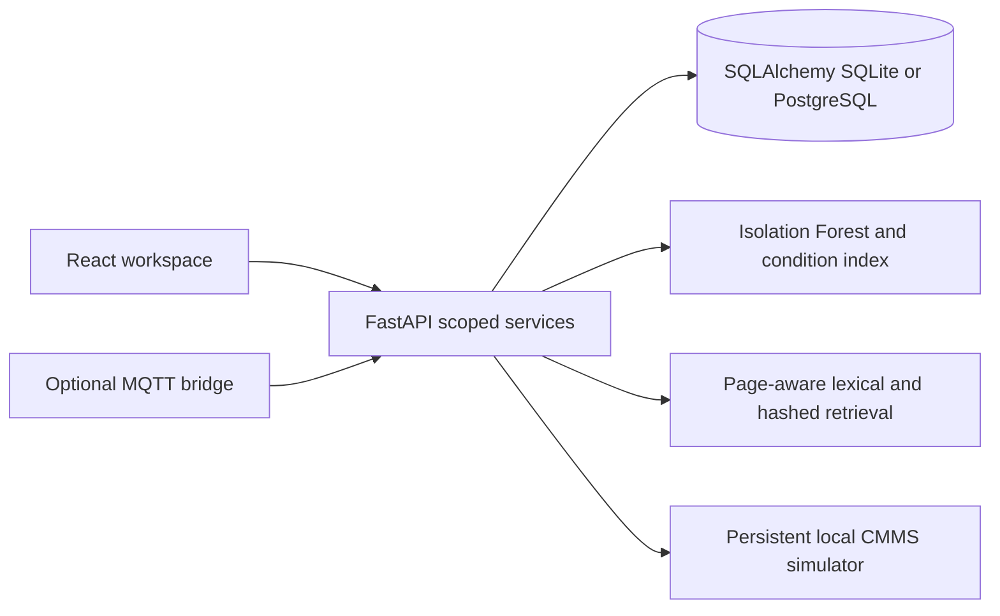

# Application architecture

The browser uses a shared typed API client. Vite proxies development requests to FastAPI, while the built application is served from FastAPI on one origin. Session cookies remain HTTP-only; a per-session CSRF token is returned to the frontend for mutations.

## Data and domain services

`backend/database.py` owns relational models and session configuration. `backend/security.py` owns password/session checks and role/site guards. `backend/intelligence.py` owns model evaluation, condition calculations, chunking, retrieval and deterministic drafts. `backend/main.py` exposes the implemented HTTP routes and transaction boundaries. `backend/seed.py` creates synthetic local fixtures.

## Mutation safety

- Idempotency records bind a user, route, request key and canonical body hash.
- Updates to workflow records use a version predicate. A stale client receives 409.
- Changing draft content saves a new immutable revision, changes authorship, clears approval and returns the investigation to review.
- Approval requires an independent authorized user, existing evidence and the current version. The approval binds the current hash and expires after 24 hours.
- Work-order planning validates the exact active approval and prevents multiple orders for the same investigation using a database constraint.
- Simulator dispatch can return an uncertain state while retaining an accepted command. Reconciliation finds that command instead of creating another one.
- Technician completion requires actual findings and an in-progress order.

## Retrieval boundary

Permitted site documents are selected before retrieval. Text chunks preserve page/version references. Answers are extractive and the maintenance draft is deterministic. Retrieved content never becomes an instruction to execute a tool. The browser renders text rather than injecting document HTML.

## Operational boundary

There is no control-system connection and no plant command tool. The default bind address is loopback. Secrets and runtime databases are excluded from source packaging. This release does not claim tenant-grade database isolation, distributed delivery semantics or cloud availability objectives.
