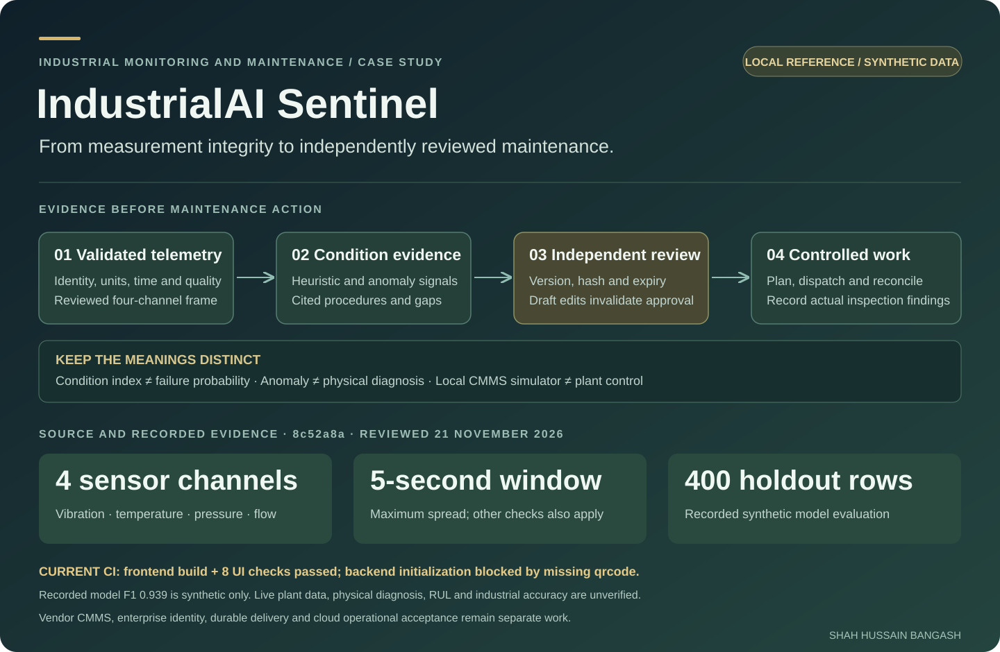
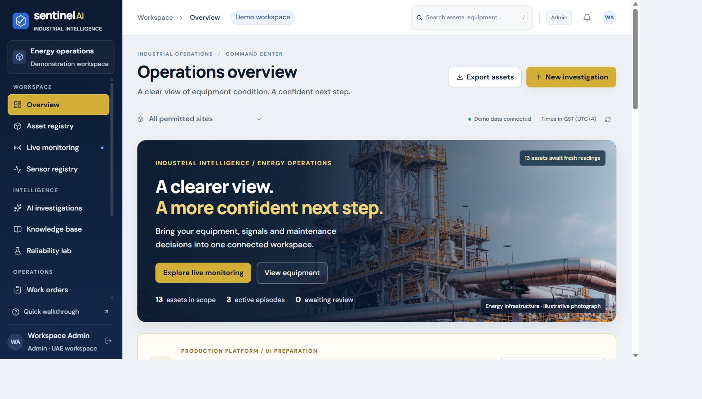
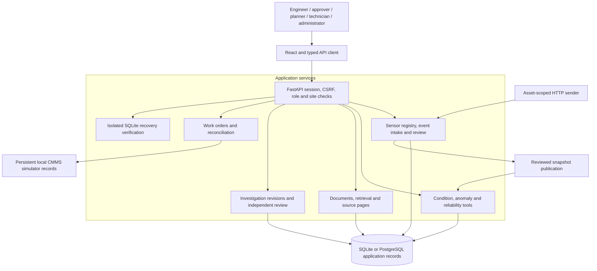
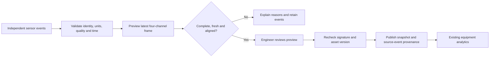
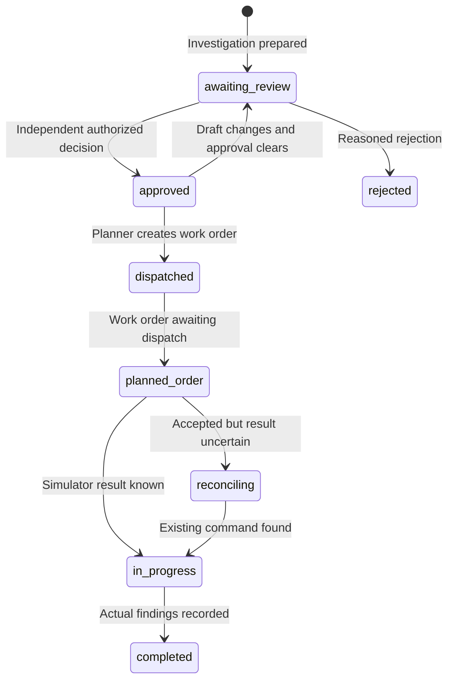

# IndustrialAI Sentinel Case Study

## Architecting evidence-led equipment monitoring and controlled maintenance workflows

**Enterprise solution architecture · Industrial analytics · Telemetry integrity · Evidence retrieval · Independent review · Security and governance · Infrastructure design · Software engineering · Applied research**

| Project | At a glance |
|---|---|
| Project owner | Shah Hussain Bangash · [GitHub](https://github.com/zenithdevelopers7-source) |
| Domain | Equipment condition monitoring, maintenance investigation and work-order tracking |
| Source baseline | [`8c52a8a`, 21 November 2026][baseline] |
| Application | React / TypeScript / Vite, FastAPI / Python and SQLAlchemy |
| Analytics | Transparent condition heuristic, synthetic Isolation Forest and explainable fleet triage |
| Evidence | Page-aware lexical and hashed-vector retrieval; deterministic drafts and extractive Q&A |
| Execution | Independent approval, version/hash checks and persistent local CMMS simulator |
| Deployment scope | Single-organization local reference application, with site membership controls; SQLite default and recorded isolated PostgreSQL verification |
| Current hosted result | [Run 44874097670][ci]: frontend build and 8 UI checks passed; backend test initialization failed because `qrcode` was unavailable |

**The architectural contribution:** Sentinel connects sensor identity and measurement quality to a time-aligned equipment view, procedure evidence, an independently reviewed recommendation and a traceable maintenance order. Its strongest engineering story is preserving evidence and authority across that path, including missing data, changed drafts and uncertain execution outcomes.

[Business objectives](#1-business-problem-and-objectives) · [Architecture](#3-solution-architecture) · [Telemetry](#4-telemetry-integrity-and-reviewed-snapshot-publication) · [Analytics](#5-condition-anomaly-and-reliability-analytics) · [Maintenance](#7-independent-review-and-work-order-execution) · [Verification](#10-engineering-evidence-and-current-release-status) · [Walkthrough](#12-technical-demonstration-and-next-delivery-gates)

## 1. Business problem and objectives

Equipment observations, procedure documents, engineering judgments and maintenance work orders often live in different systems. A rising vibration value can deserve attention without identifying a physical fault. Missing or bad-quality readings can be misinterpreted as normal operation. A recommendation can change after someone approves it, and an external work-order request can be accepted even when the caller receives no confirmation.

Sentinel addresses these coordination problems through a connected local workflow. The engineer inspects telemetry and evidence, an independent reviewer assesses the recommendation, the planner creates and dispatches an order, and a technician records actual findings.

| Objective | Architectural response | Business measure for a future pilot |
|---|---|---|
| Make measurements interpretable | Stable sensor identity, raw/canonical values, quality and observed/received timestamps | Invalid-data rate, freshness coverage and time to resolve data exceptions |
| Avoid combining unrelated observations | Explicit four-channel alignment preview and publication | Rejected/stale frames and valid-snapshot coverage |
| Support explainable triage | Condition heuristic, anomaly indicator, source passages and score breakdown | Review effort, alert burden and agreement with domain reviewers |
| Preserve decision accountability | Versioned drafts, independent approval, payload hash and expiry | Self-review/stale-decision rejection and review turnaround |
| Follow action through completion | Work-order state, simulator reconciliation and required findings | Uncertain-order age, duplicate effects and completion quality |

These are proposed outcome measures. Reduced downtime, fewer failures, lower maintenance cost or improved plant safety have not been demonstrated by the synthetic system.

## 2. A connected maintenance journey

1. An engineer opens a permitted asset and reviews its readings, data quality, trend and condition episodes.
2. Independent sensor events are inspected; a complete aligned frame can be explicitly published for snapshot analytics.
3. A fresh good-quality reading supports an investigation, with observed facts, possible explanations, procedure citations and a draft checklist.
4. The engineer edits the recommendation if needed, creating a new revision and invalidating prior approval.
5. A different authorized reviewer decides on the exact current payload and records a reason.
6. A planner creates a work order under the active approval and dispatches it to the local simulator.
7. An uncertain response is reconciled against the existing simulated command. A technician then records actual findings to complete the order.

*Updated interface captured from the running local demonstration workspace on 21 November 2026. This view shows the current navigation, operations brief and illustrative infrastructure photograph. Displayed counts and readings are demonstration data; the freshness notice explicitly identifies assets awaiting fresh readings. The screenshot illustrates the local interface and does not extend the source-baseline verification claims in this case study.*

## 3. Solution architecture

*Logical source responsibilities. There is no plant-control tool or verified vendor CMMS deployment. The simulator uses application-managed local records, not an independently operated external service.*

The application keeps its browser/API interaction on one origin in the built configuration. SQLAlchemy models own persisted readings, sensor events, investigation revisions, approvals, work orders, audit, documents and identity records. Site memberships constrain accessible equipment and evidence.

The current hierarchy models one organization, sites, areas, equipment systems and placements. The [foundation module][foundation] explicitly does not claim multi-tenant isolation. Site access and a richer organization tree should not be confused with tenant-grade database separation.

| Concern | Source starting point |
|---|---|
| HTTP workflow and transaction boundaries | [`backend/main.py`][main] |
| Relational models and constraints | [`backend/database.py`][database] |
| Password/session, role and canonical-site checks | [`backend/security.py`][security] |
| Unit conversion and atomic sensor-event batches | [`backend/sensor_events.py`][events] |
| Time alignment and provenance publication | [`backend/projections.py`][projections] |
| Asset-scoped ingestion credentials | [`backend/gateways.py`][gateways] |
| Model, condition and retrieval logic | [`backend/intelligence.py`][intelligence] |
| Backup inventory and isolated restoration checks | [`backend/recovery.py`][recovery] |

## 4. Telemetry integrity and reviewed snapshot publication

### Preserve identity and measurement context

The sensor registry assigns stable identifiers to vibration, temperature, pressure and flow channels. Independent events retain message identity, raw value/unit, canonical value/unit, quality, source, observation time, reception time and conversion version.

The [conversion implementation][events] supports bounded unit mappings. For example:

| Raw measurement | Canonical measurement |
|---|---|
| 0.1 in/s vibration | 2.54 mm/s |
| 158 °F | 70 °C |
| 500 kPa | 5 bar |
| 2,000 L/min | 120 m³/h |

The [reference record][reference] reproduces the arithmetic from these mappings. It is not a sensor calibration result.

Atomic batches accept 1–500 events. Sensor/message identity deduplicates exact redelivery; changed content under the same identity conflicts and rolls the batch back. Ingestion does not silently publish an equipment snapshot. An opt-in quarantine/review path separately preserves rejected inputs and records correction/replay or dismissal decisions.

### Treat machine credentials as a narrower authority

Administrators can issue, rotate or revoke a credential restricted to one asset's event intake. Only the secret hash is retained, and plaintext is displayed once rather than saved in idempotency receipts. Requests check expiry, revocation, the issuer's current administrator role and canonical site access.

The credential grants no document, approval or work-order authority. Its source label identifies an application gateway record; it does not attest a physical device. Broker identity, durable edge spooling, rate limits and managed device provisioning remain separate work.

### Align before interpreting

Four individually valid measurements can still describe different operating moments. The [snapshot projection service][projections] selects the latest event for each channel and requires valid conversions, bounded finite values, good quality, current per-sensor freshness and non-future observation times. It also requires a maximum five-second spread and a frame newer than the latest equipment snapshot.

A spread of exactly 5.000 seconds satisfies the spread condition; 5.001 seconds does not. Spread alone is insufficient: all the other eligibility checks must pass. The preview signature includes frame and current-state context, so changed inputs require a refreshed review before publication. Publication uses a version-guarded asset update and records source-event IDs.

An important design consequence is that the latest bad-quality event blocks that channel's frame rather than silently substituting an older good measurement. Data uncertainty remains visible instead of being converted into apparent equipment health.

## 5. Condition, anomaly and reliability analytics

### Separate three different meanings

**Condition index:** a transparent heuristic based on vibration and temperature. **Anomaly indicator:** deviation from a synthetic four-variable training distribution. **Maintenance decision:** a qualified person's assessment of observations, procedure applicability and inspection findings.

These outputs answer different questions. None of them independently establishes a failure mode, failure probability or remaining useful life.

### Explain the condition index

The implemented penalty is:

`max(0, (vibration − 1.6) × 10.8) + max(0, (temperature − 70) × 0.65)`

The index is the rounded remainder from 100, clipped to 8–99. Below 45 is `critical`; below 75 is `warning`; otherwise `healthy`. Non-good-quality input returns `unknown` with no health value.

| Reference input | Heuristic result |
|---|---|
| 2.0 mm/s and 70 °C, good quality | 96, healthy |
| 4.5 mm/s and 80 °C, good quality | 62, warning |
| 6.0 mm/s and 90 °C, good quality | 39, critical |
| 2.0 mm/s and 70 °C, bad quality | Unknown; no health score |

These are reproduced source-formula examples. The coefficients and thresholds are demonstration settings, not validated OEM limits or an industrial standard.

### Evaluate the synthetic anomaly model honestly

The source trains an Isolation Forest with 80 estimators on 1,500 synthetic observations using seed 41. Evaluation uses a separately generated seed-89 holdout containing 300 normal and 100 abnormal observations. Its [recorded report][model-report] contains:

| Metric | Recorded synthetic result |
|---|---:|
| Precision | 0.885 |
| Recall | 1.000 |
| F1 | 0.939 |
| False positives | 13 of 300 normal observations |
| Training / evaluation samples | 1,500 / 400 |

The recorded counts and recall imply 100 true positives, 13 false positives, zero false negatives and 287 true negatives. The local [arithmetic audit][reference] recomputes the rounded metrics consistently. It does not retrain or rerun the model.

The abnormal distribution is deliberately separated from the normal distribution. This cannot establish sensitivity to real degradation, robustness across equipment types or performance under changing operating regimes. Scikit-learn's [Isolation Forest documentation][sklearn] describes an outlier detector, which is a different claim from a physical diagnosis or calibrated failure-risk model.

### Make fleet triage inspectable

The [Reliability Lab][lab] combines condition contribution, asset criticality, unresolved episodes and overdue work into a transparent ranking. Assets without a current good-quality index enter Data review. Comparisons use bounded recorded samples on shared time/value axes; slope uses elapsed time rather than sample index.

What-if scenarios compare hypothetical values with an exact recorded baseline. Saved runs retain inputs, baseline, method/model version and result; a fingerprint rejects a changed baseline. They do not update telemetry, control equipment or create a maintenance order. This is scenario analysis, not a calibrated physical digital twin or RUL model.

## 6. Evidence retrieval, document provenance and AI boundaries

Uploaded PDF/text procedures are parsed into page-aware text. New uploads retain original bytes in the local database; scoped downloads verify length/hash consistency. Older records may explicitly lack originals. The current parser is synchronous and bounded; OCR, malware scanning and isolated parser processes remain hardening work.

The retrieval code combines lexical overlap with a 256-dimensional deterministic hashed-token vector. It requires lexical overlap before ranking, preserves page/version/checksum metadata and limits repeated results from a page. These vectors are not semantic embeddings, and retrieval is not demonstrated as bilingual or industrially benchmarked.

Site-permitted documents are selected before retrieval. An unsupported knowledge query produces an insufficient-evidence response. Returned passages are evidence for review; the Q&A path does not generate a free-form model answer. The investigation draft is also deterministic and lists observations, possible explanations, gaps and a checklist.

This design makes the current boundary inspectable: no LLM provider, LangGraph/MCP agent runtime or plant command is active. A future generative assistant could assemble a cited exception brief, but it would need representative evaluation, current document authorization, applicable procedures, bounded tools and review before influencing action. Adding an agent framework would not itself supply those controls.

## 7. Independent review and work-order execution

### Bind the decision to the recommendation

The investigation starts from a fresh good-quality snapshot and stores a payload hash. Editing saves a new recommendation revision, updates authorship, clears approval and returns the investigation to review. The decision route checks the expected version and permits an approver/admin only when they differ from the current author. Approval also requires document evidence.

An approved payload has a 24-hour validity window in the current source. Work-order planning requires the current matching approval. These settings demonstrate a control mechanism; a plant or maintenance organization would need to approve its own policy and procedure applicability rules.

*Combined view of investigation and order progression; the application stores their states separately. Completion does not itself establish a verified repair.*

### Make concurrency and retries explicit

Mutation requests bind idempotency keys to the user, route and canonical request body. Changed content under a reused key conflicts. Workflow updates use an expected version and conditional database update to reject competing changes. A database constraint prevents multiple work orders for the same investigation.

The local simulator can persist an accepted command while presenting the work order as `reconciling`. The reconciliation route finds that command and returns its existing reference rather than creating another. Technician completion requires an in-progress order and actual findings text.

The simulator is application-managed local state, so this does not validate distributed vendor delivery semantics. A real CMMS adapter would need its own authentication, idempotency, timeout/crash, webhook and reconciliation contract. The current application does not command a PLC or execute a physical maintenance operation.

## 8. Security, administration and recovery

| Boundary | Source mechanism | Remaining enterprise work |
|---|---|---|
| Human identity | Password hashes, hashed opaque sessions, HttpOnly cookies and CSRF/origin checks | Reviewed SSO, identity lifecycle, distributed throttling and independent assessment |
| Site access | Canonical membership resolution and service-side resource guards | Wider organizational policies and tenant-grade database controls |
| Machine identity | One-asset credentials with hash-only storage, expiry, rotation and revocation | Managed provisioning, device attestation, transport and monitored deployment |
| Maintenance authority | Independent author/reviewer, version/hash binding and role-limited actions | Approved maintenance authority matrix and operating procedures |
| Document exposure | Scoped reads/downloads and checked original bytes | Reviewed publication/lifecycle, retention and hardened parsing |
| Audit | Persisted actor, action and workflow records | External protected retention and independent tamper-resistance |

### Administrator MFA adds a key-custody obligation

The newer [administrator MFA increment][mfa-doc] adds TOTP enrollment, a password-plus-factor sign-in challenge, encrypted secrets, replay controls and hashed single-use backup codes. Company enforcement is staged until active administrators enroll. The code and tests exist, but the current hosted backend run did not execute them because initialization failed.

A database restore does not restore the private MFA encryption key. The recovery documentation requires that key to be protected separately; losing it can leave restored encrypted factors unusable. This is an operating dependency to include in recovery design. TOTP does not provide phishing resistance, and enterprise key management/recovery processes remain separate acceptance work.

### Verify recovery without replacing the live database

The [recovery service][recovery] creates a checked SQLite copy and restores into a new isolated folder for read-only verification. It compares database integrity, foreign keys, schema, table content and retained original-file bytes, while counting documents without originals.

The service is bounded to local SQLite verification, including a 256 MiB database limit and a 30-second copy budget. It does not start the restored application, replace the live database, copy data off-device, recover PostgreSQL or include configuration/dependencies/MFA key custody. A successful check is useful evidence, but does not establish end-to-end disaster recovery or an RTO/RPO.

NIST's [OT security guidance][nist-ot] emphasizes the performance, reliability and safety context of systems interacting with the physical environment. For a future plant integration, network boundaries, change authority and operating ownership must be designed with the site's OT team; the local reference is not a certified control system.

## 9. Infrastructure and deployment design

The current default is a local FastAPI application serving the built React interface, with SQLite persistence. PostgreSQL, Docker and an optional MQTT bridge have separate source/configuration paths. Their existence does not establish a managed cloud deployment or live broker/plant integration.

The source now includes migrations through `0011_admin_mfa`. Earlier verification records describe older schema revisions, so their test counts must not be presented as current full-suite results. A release packet should record source, image, schema, configuration, model artifact, key dependencies and tested environment together.

| Operating concern | Existing foundation | Next acceptance evidence |
|---|---|---|
| Release reproducibility | Lockfiles, frontend CI and backend test configuration | Complete dependency declaration and a passing clean backend run |
| Database | SQLAlchemy, migrations and isolated historical PostgreSQL observations | Current-schema upgrade, preservation, runtime-role and representative workload checks |
| Telemetry delivery | Scoped HTTP credentials, event deduplication and alignment policy | Device identity, durable edge delivery, broker failure and backlog testing |
| Recovery | Isolated database/original-file verification | Application startup, matching secrets, external-state reconciliation and off-device exercise |
| Observability | Request timing, activity and local operational panels | Central metrics/traces, data freshness SLOs, alerts and on-call ownership |
| Cost and capacity | Bounded local query/scenario behavior | Fleet/sample workload, concurrent users, retention cost and processing latency |

A future cloud pilot needs a validated network and identity design, encrypted/private storage, secret management, monitored deployment and a measured restore. No availability percentage, cloud bill, maximum supported fleet or recovery objective has been established by the evidence here.

## 10. Engineering evidence and current release status

### Current hosted run

The [21 November 2026 run][ci] for the pinned source had the following outcome:

| Step | Observed result | Meaning |
|---|---|---|
| Frozen frontend dependency installation | Passed | Configured lockfile installation completed |
| TypeScript/Vite build | Passed | Frontend compiled and built |
| UI checks | 8 passed, 0 failed | Node-based frontend logic checks; not an interactive browser/device acceptance run |
| Locked Python installation | Passed | The listed packages installed |
| Backend test initialization | **Failed** | `ModuleNotFoundError: No module named 'qrcode'` while importing the MFA router through test setup |
| Overall workflow | **Failed** | No current hosted backend-suite pass is established |

The immediate release gate is to reconcile all required dependencies for the MFA increment and rerun the backend suite from a clean environment. This case-study change does not alter the application's dependency files or claim to resolve that failure.

### Historical records and selected local arithmetic

| Evidence | Recorded scope | Boundary |
|---|---|---|
| [Phase 3 Step 9 record][step9-evidence] | 172 SQLite tests and 172 isolated PostgreSQL 18.6 tests; gateway sender/rotation/revocation and logical restore observations | Historical schema `0008`, not current schema `0011`; browser acceptance pending in that record |
| [Model evaluation record][model-report] | 1,500 synthetic training and 400 holdout observations; F1 0.939 | Recorded synthetic separation only; not industrial accuracy |
| [Verification history][verification] | Incremental migration, original-file, recovery and workflow observations | Results belong to their listed releases and environments |
| [Local arithmetic record][reference] | Metric consistency, four condition examples, four conversions and alignment boundary illustrations | No model inference, backend suite, database or physical device was executed in this replay |

The [reproduction script][reference-script] preserves the arithmetic assumptions. Historical test counts are not additive, and current frontend passes do not override the backend initialization failure. The case study's claims distinguish source behavior, recorded observations and newly reproduced calculations.

## 11. Research questions and next experiments

| Question | Study design | Measures |
|---|---|---|
| Does anomaly detection generalize across equipment and operating states? | Use permissioned historical data with machine/time-separated splits and inspection labels | Precision/recall, false alerts per asset-day, lead time and subgroup errors |
| Do quality/alignment gates improve investigations? | Compare frames with injected stale, bad-quality, reordered and delayed channels | Incorrect-frame acceptance, data-review load and evidence completeness |
| Does evidence retrieval improve recommendation quality? | Compare lexical baseline, a candidate semantic method and expert-selected procedures | Applicable-source recall, unsupported recommendations, abstention and review effort |
| Is a generative assistant useful? | Evaluate cited drafts against deterministic drafts using an agreed domain rubric | Added useful content, errors, latency, cost and reviewer acceptance |
| Are recovery and external orders consistent after faults? | Use isolated crashes/restores and an authorized CMMS sandbox | Duplicate effects, uncertain-state handling, data loss and measured recovery time |

Freeze dataset provenance, labels, operating-state slices and configurations before evaluation. Account for repeated windows from the same asset and report uncertainty around sparse failure classes. Measure downstream review burden alongside detection quality.

This is a path toward applied industrial-AI research. Current synthetic metrics, heuristic scenarios and a graph-like business workflow do not establish a calibrated digital twin, remaining useful life, autonomous agent platform or novel fault-diagnosis model.

## 12. Technical demonstration and next delivery gates

A ten-minute architecture discussion can follow one synthetic asset:

1. **Telemetry:** inspect sensor identity, raw/canonical units, timestamps and quality.
2. **Alignment:** show why an incomplete, stale or more-than-five-second frame is blocked, then review a valid preview and its source-event provenance.
3. **Analytics:** distinguish the condition index from the anomaly indicator, and explain the synthetic model's evaluation scope.
4. **Evidence:** open a procedure citation and identify whether it is applicable, current and synthetic.
5. **Review:** edit the recommendation, show the new revision/cleared approval, and use a different authorized reviewer.
6. **Execution:** create a work order, exercise uncertain simulator acceptance, reconcile and record findings.
7. **Release judgment:** show the current CI result and the specific evidence required before a broader deployment.

| Priority | Delivery gate | Completion evidence |
|---|---|---|
| 1 | Reproducible current release | Dependency fix, clean full backend run, current schema and recorded role-based UI journey |
| 2 | Representative analytics | Permissioned industrial data, independent labels, held-out evaluation and domain review |
| 3 | Hardened identity/evidence | Approved SSO/MFA recovery, current access tests, procedure publication and protected originals |
| 4 | Durable real integration | Scoped device/broker and CMMS sandbox contracts with failure/reconciliation evidence |
| 5 | Operational pilot | Workload/cost measurements, isolated full restore, monitored deployment and accountable acceptance |

Sentinel demonstrates the connection between measurement integrity, explainable analytics and controlled maintenance execution. The next stage is to complete reproducible release verification, evaluate representative equipment data and validate the real operational boundaries.

---

**Evidence reviewed:** 21 November 2026. Application statements refer to the pinned source. The screenshot and earlier verification reports retain their original demonstration scope. No live equipment, external message or paid cloud resource was changed for this case study.

[baseline]: https://github.com/zenithdevelopers7-source/IndustrialAI-Sentinel/commit/8c52a8a8ef78457a1f218638ab2bf6f27a1907a5
[ci]: https://github.com/zenithdevelopers7-source/IndustrialAI-Sentinel/actions/runs/44874097670
[main]: https://github.com/zenithdevelopers7-source/IndustrialAI-Sentinel/blob/8c52a8a8ef78457a1f218638ab2bf6f27a1907a5/backend/main.py
[database]: https://github.com/zenithdevelopers7-source/IndustrialAI-Sentinel/blob/8c52a8a8ef78457a1f218638ab2bf6f27a1907a5/backend/database.py
[security]: https://github.com/zenithdevelopers7-source/IndustrialAI-Sentinel/blob/8c52a8a8ef78457a1f218638ab2bf6f27a1907a5/backend/security.py
[foundation]: https://github.com/zenithdevelopers7-source/IndustrialAI-Sentinel/blob/8c52a8a8ef78457a1f218638ab2bf6f27a1907a5/backend/foundation.py
[events]: https://github.com/zenithdevelopers7-source/IndustrialAI-Sentinel/blob/8c52a8a8ef78457a1f218638ab2bf6f27a1907a5/backend/sensor_events.py
[projections]: https://github.com/zenithdevelopers7-source/IndustrialAI-Sentinel/blob/8c52a8a8ef78457a1f218638ab2bf6f27a1907a5/backend/projections.py
[gateways]: https://github.com/zenithdevelopers7-source/IndustrialAI-Sentinel/blob/8c52a8a8ef78457a1f218638ab2bf6f27a1907a5/backend/gateways.py
[intelligence]: https://github.com/zenithdevelopers7-source/IndustrialAI-Sentinel/blob/8c52a8a8ef78457a1f218638ab2bf6f27a1907a5/backend/intelligence.py
[recovery]: https://github.com/zenithdevelopers7-source/IndustrialAI-Sentinel/blob/8c52a8a8ef78457a1f218638ab2bf6f27a1907a5/backend/recovery.py
[lab]: https://github.com/zenithdevelopers7-source/IndustrialAI-Sentinel/blob/8c52a8a8ef78457a1f218638ab2bf6f27a1907a5/docs/RELIABILITY_LAB.md
[mfa-doc]: https://github.com/zenithdevelopers7-source/IndustrialAI-Sentinel/blob/8c52a8a8ef78457a1f218638ab2bf6f27a1907a5/docs/ADMIN_MFA.md
[model-report]: https://github.com/zenithdevelopers7-source/IndustrialAI-Sentinel/blob/8c52a8a8ef78457a1f218638ab2bf6f27a1907a5/docs/evidence/synthetic-model-evaluation.json
[step9-evidence]: https://github.com/zenithdevelopers7-source/IndustrialAI-Sentinel/blob/8c52a8a8ef78457a1f218638ab2bf6f27a1907a5/docs/evidence/phase3-step9-verification.json
[verification]: https://github.com/zenithdevelopers7-source/IndustrialAI-Sentinel/blob/8c52a8a8ef78457a1f218638ab2bf6f27a1907a5/docs/VERIFICATION.md
[sklearn]: https://scikit-learn.org/stable/modules/generated/sklearn.ensemble.IsolationForest.html
[nist-ot]: https://csrc.nist.gov/pubs/sp/800/82/r3/final
[reference]: evidence/industrialai-reference-2026-11-21.json
[reference-script]: evidence/reproduce_industrialai_reference.py
